# Taste Engine

A desktop app that pulls my anime list (MyAnimeList), listening history (Last.fm), books (Hardcover), and film and TV ratings (TMDB) into one SQLite database, shows how my taste compares to everyone else's, suggests what to watch and listen to next, and makes a recap of every month and year. It runs on my own computer and keeps everything there.

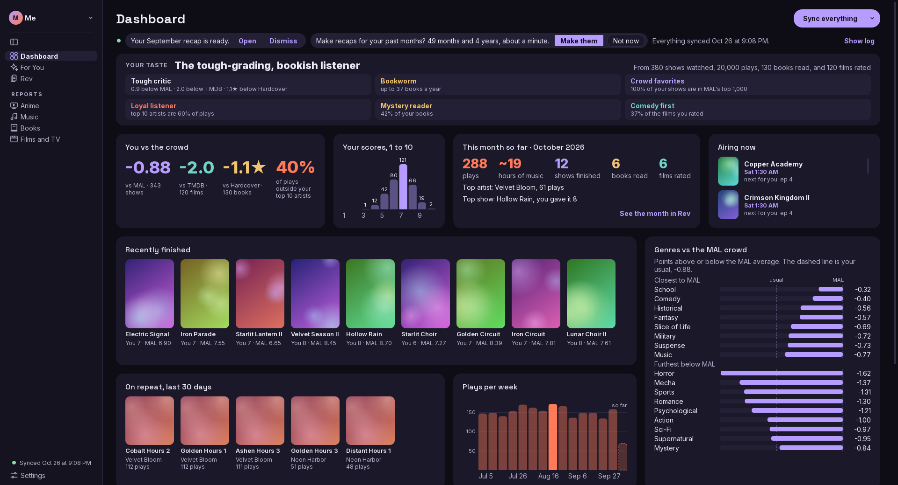

*Every screenshot here shows a made-up demo library (invented titles, artists, books, scores, and plays, with generated artwork), not my own data.*

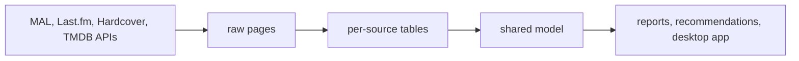

## Run it

**Windows:** download the latest `taste-engine-<version>-windows-x64-setup.exe` from [Releases](../../releases) and run it. It installs just for me, with no admin prompt, to `%LOCALAPPDATA%\Programs\Taste Engine`, and adds a Start menu shortcut (a desktop one is optional). Windows warns the first time because the installer isn't signed: click **More info**, then **Run anyway**.

The setup follows the Windows light or dark setting. Running it again offers to update, repair, or uninstall; if the app is open, updating offers to close it and uninstalling asks me to close it first. Uninstalling keeps my profiles and settings unless I tick the box to delete them too, along with the saved API keys.

**From source** (Python 3.10+):
```
pip install -r requirements.txt
python -m taste.desktop
```

## Use it

### Profiles and sources

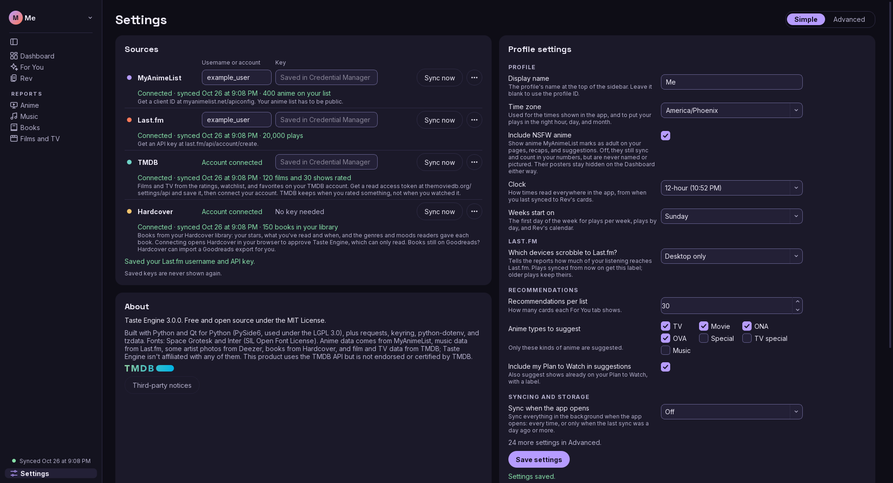

Create a profile. Each profile has its own keys, settings, and data. The profile's name sits at the top of the sidebar; click it to switch profiles, add one, or give a profile its own picture.

On **Settings**, the **Sources** card has one row per source, each the same shape: whether it's connected, when it last synced and how much it holds, then the username and key (or a Connect button), **Sync now**, and a ⋯ menu with **Test connection** and **Remove** or **Disconnect**. **Save** shows up once I've typed something. MyAnimeList needs my username and a [client ID](https://myanimelist.net/apiconfig), Last.fm my username and an [API key](https://www.last.fm/api/account/create). For books, **Connect…** opens [Hardcover](https://hardcover.app/) in the browser to approve read-only access, and the app picks up where the browser sends me back. Goodreads closed its public API in 2020, but Hardcover can import a Goodreads export, and from then on its API keeps everything current. For films and TV, I save a free TMDB read access token, then **Connect…**, which also opens the browser to approve read-only access.

The rest of Settings opens in **Simple**, with the everyday settings and a sentence under each saying what it does; Simple covers things like a 12- or 24-hour clock, whether weeks start on Sunday or Monday, and syncing when the app opens (every time or once a day). **Advanced** adds report limits, syncing, and storage, plus which cards the Dashboard shows (the rest widen to fill the room), whether report pages open on all time or the latest year, how many votes a TMDB average needs before film and TV picks trust it, and how big the picture cache can grow. **Motion** is Full (pages and new cards fade in, panels slide, pictures fade in), Reduced (quick fades only), or Off. When Windows' own animation effects are off, the app doesn't animate either.

### Syncing

On the **Dashboard**, click **Sync everything** (its arrow lists each connected source, to sync just one). The first time, it also fetches what the recommendations need, which takes a few minutes for a big list. After that it's seconds: Hardcover sends only the books that changed, with a full read once a week. While it runs, a status line shows each step and its progress; **Show log** has the details, and a sync with problems turns the line red. When everything synced together, the line says so once.

### Dashboard

The **Dashboard** (at the top of this page) opens with **Your taste**: a one-line description of me worked out from all of it ("The night-owl, tough-grading anime fan with a soft spot for fantasy"), and the traits behind it, each with its number, like "41% of plays between 10 PM and 4 AM". Fixed rules, no AI service; a medium without enough data says nothing. Traits that say the same thing about different media fold into one, like "Tough critic: 0.9 below MAL, 2.0 below TMDB, 1.1★ below Hardcover". Below it: **You vs the crowd** (my average against MAL's, TMDB's, and Hardcover's for the same titles, and how much of my listening goes beyond my ten most played artists), my scores 1 to 10, this month so far, what I finished lately, the albums on repeat, plays per week, and which genres I'm most generous or harshest with. Once books and films are in, their shelves join it. The cards share the window's height, so full screen gives bigger posters and more genres instead of empty space, and a new profile gets a short getting-started panel instead of empty cards. Since my scores are whole numbers, "lower" and "higher" than MAL count against its average rounded to a whole score: a 7 for a show MAL rates 7.2 matches it.

**Airing now** sits beside This month when a show on my Watching list is currently airing. Each row has its poster, title, and MAL's next weekly broadcast in my profile's time zone, followed by "next for you: ep 7" from my list progress. That isn't a claim about which episode airs next: MAL doesn't give that history. The last known episode is marked "final episode", and a show without a schedule says "no set time" and sorts last. If I've already recorded every known episode, it says so. The card updates after a MAL sync, and changing my clock or time zone changes its times without another sync. I can turn it off in Dashboard cards; when nothing is airing, it disappears by itself. Adult shows stay out while Include NSFW anime is off.

### For You

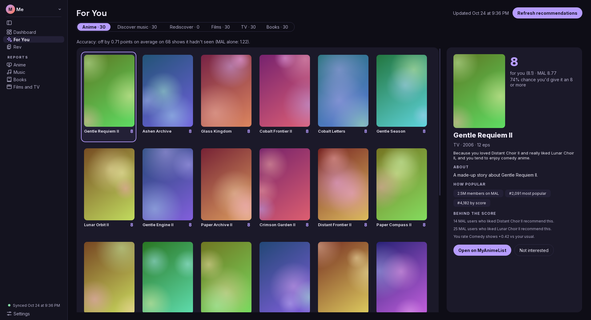

**For You** is a grid of picks with a panel beside it for the one I've clicked. The panel says what the pick is (MAL's synopsis, the artist's Last.fm bio, the film or show's TMDB overview, or the book's Hardcover description) and how popular it is (MAL members and rank, Last.fm listeners, TMDB votes, Hardcover readers). Anime suggestions each come with the whole score I'd most likely give (the exact prediction and the MAL mean beside it), the chance I'd give it an 8 or more, and a one-line reason in plain words ("Because you loved A and really liked B"). Music has new artists to try, each with how closely Last.fm says it matches (like "95%, Strong match"), and old favorites to rediscover. **Films** works like anime: TMDB's recommendations for the films I rated highest, each with a predicted rating for me next to the TMDB average. Films that aren't out yet are left out, and an average built on few votes counts for less, so a brand-new film's early hype doesn't top the list. **TV** has its own tab after Films. It uses the same model on my TV ratings, with creators instead of directors, and starts from TMDB's recommendations for shows I rated above my own TV average, plus my watchlist. Anime stays out of it (MAL and the Anime tab cover that), going by TMDB's animation genre and Japanese origin. Shows not out yet are left out, thin TMDB averages count for less, and watchlist picks are marked. The reason reads like a sentence; the individual shows and my ratings are kept under Behind the score. TV episode lengths say "45m episodes", so I do not mistake one episode for the whole show. A small library uses my usual difference from TMDB; the chance of an 8 or more appears only once there are at least 20 rated shows to check it against. **Books** too: Hardcover's similar books for the ones I rated highest (plus my Want to Read), with predicted stars next to the Hardcover average. The last list, [Across everything](#across-everything), mixes them all.

### Reports

| | |
|---|---|
| 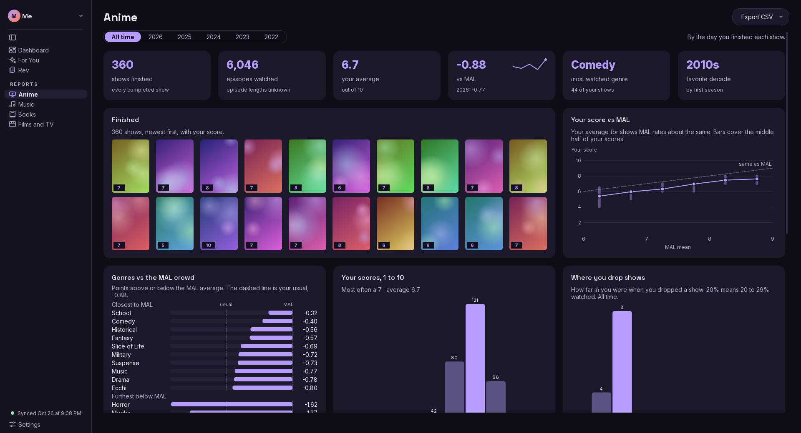 | 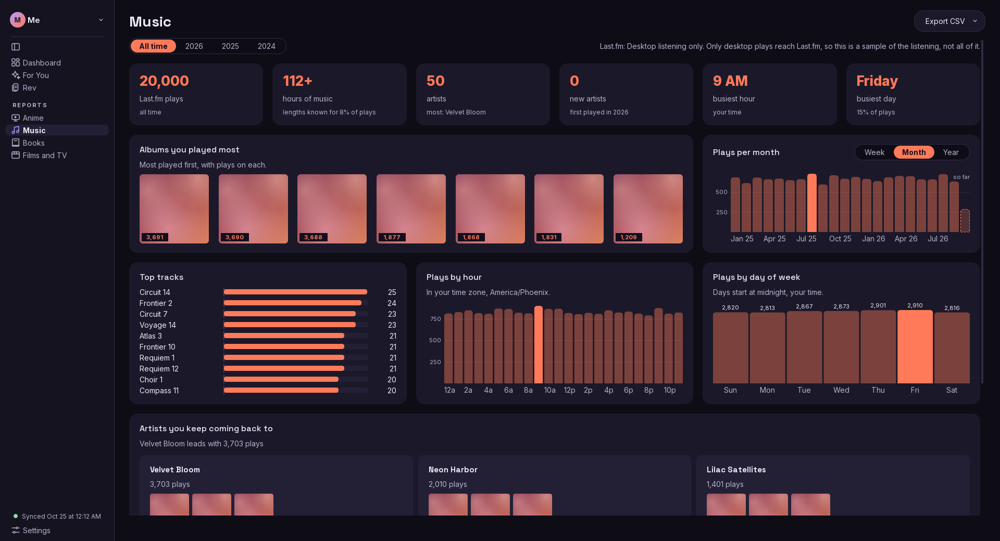 |
| 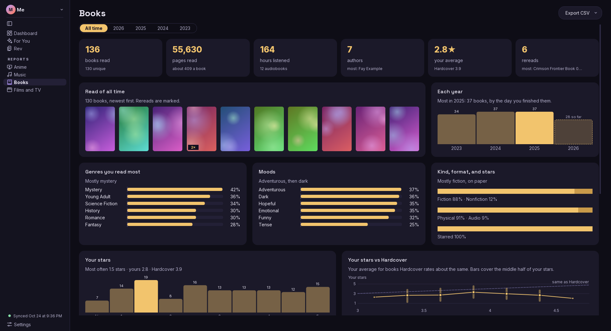 | 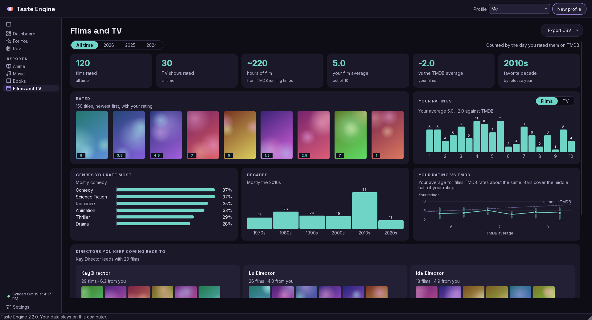 |

**Reports** is all charts, one page per medium under Reports in the sidebar, and every page has the same shape: All time or any one year, six numbers across the top, the pictures beside the main chart, three more charts, then the people I keep coming back to. **Anime**: the shows I finished with my score on each, my average for shows at each level of the MAL mean, my scores 1 to 10, genres I rate closest to and furthest below MAL, where I tend to drop shows, and the studios I watch most. **Music**: the albums I played most, plays per week, month, or year (as many as fit the window), top tracks, plays by hour and day, and my top artists with their plays month by month. **Books** borrows from Hardcover's own stats page, for all time or any one year: books, pages, and hours listened, the covers I read (rereads marked), books per year, genres and moods, fiction against nonfiction, paper against ebook and audio, and how many I gave stars, my stars in half steps, my stars against Hardcover's average for books it rates about the same, and my most read authors with my stars for each of their books in reading order. **Films and TV** works like Books, for all time or a year: films and shows rated, hours of film, my average against TMDB's, the posters with my rating on each, my ratings (Films or TV), genres, decades, my rating against TMDB's average for titles it rates about the same, and the directors I keep coming back to. Short charts show their counts and long ones a scale. Every tile across the top has a number, never a dash, and a second line (like "+4 finished this month") and, for points against MAL, a small line by year. The numbers behind everything are in **Export CSV**, one report at a time or all at once.

### Rev

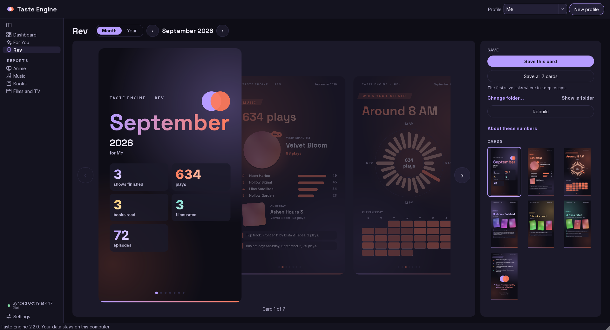

**Rev** is my month or year as a deck of up to seven phone-sized cards (eight for a year, with [how my taste changed](#taste-over-time)), swiped through with the arrows (or the arrow keys): the month at a glance, my music (plays, about how many hours, top artists and albums), when I listened, shows finished and how I scored them against MAL, books, films and TV, and a last card comparing it with the month before plus one closing sentence. On the first launch with past history (or the first sync of a new profile), the Dashboard offers to make my missing monthly and yearly recaps. **Make them** shows progress on the sync line; if I close the app partway through, it continues next time. **Not now** leaves them for me to open one at a time on Rev. Each recap makes itself after its month ends (on the next launch or sync) and keeps itself up to date for two weeks while late plays and dates come in, and the Dashboard says when one is ready. Beside the deck, every card is a thumbnail to jump to. **Save this card** asks for a folder the first time and saves straight there after that; **Save all** saves the whole deck. Nothing is uploaded; sharing a card is up to me.

### Around the app

The sidebar has Dashboard, For You, and Rev at the top, then the four report pages under **Reports**. It collapses to icons with the button at its top or **Ctrl+B**, and the app remembers which way I left it. Settings sits at the bottom, with when I last synced just above it.

Keys and sign-in tokens are stored in Windows Credential Manager, never in plain text, and never shown again after saving. Data lives in `%LOCALAPPDATA%\taste-engine` for the packaged app, or `data/` when run from source.

There's also a command line:
```
python -m taste --profile me sync all
python -m taste --profile me sync hardcover
python -m taste --profile me report
python -m taste --profile me status
python -m taste profiles
```

## How the anime suggestions work

I get anime film suggestions on the Anime tab, including in Across everything.
Films leaves them out of suggestions, while my rated anime films still count in
the film model and the Films and TV report.

Candidates are shows that MAL users recommend alongside shows I scored above my own average, plus sequels and related shows of things I liked. On Usual, each one gets a predicted score for me in two steps:

1. **Start from the MAL mean.** With 30 or more scored shows, the app fits my score as a straight line in the MAL mean instead of just subtracting my usual difference. A harsh critic is often harsher on weak shows than on strong ones, and a line captures that. With fewer shows a fitted line swings too much, so it stays a plain shift.
2. **Add my leans.** What's left after step 1 is averaged per genre and per studio, so a show gets a bump for genres and studios I rate above that baseline. Small samples are pulled toward zero, so one show can't swing a whole genre.

To check that this beats simply trusting MAL, the app hides a fifth of my scored shows, predicts them, and compares the error with the MAL mean alone. Both guess whole scores, like the ones I give, which also misses by a little less than the raw decimal does. The result is shown on the For You page, so I can see whether the personal part actually helps.

The averages themselves stay decimal: rounding the MAL mean before comparing would only add noise (a show at 7.49 and one at 7.51 are nearly the same, but would become a 7 and an 8).

Predictions are averages, so they rarely reach the top of the scale. That's why each card also says how likely I am to give the show an 8 or more. The app predicts each of my scored shows without its own score (in five rounds), looks at how far my real scores landed from those predictions, and applies the same spread to the new show. It's left out when I have fewer than 20 scored shows.

The reason on each card names the shows I liked that point to it, using English titles when MAL has one. The vote counts and genre numbers behind it are in the card's tooltip.

## Choosing a rating model

After the first page appears and launch sync finishes or is skipped, the app asks how
For You should guess my ratings. It asks once per profile for this set of models, then
asks again only when the set changes. Decide later leaves it for my next launch. If no
list has twenty rated titles yet, it skips the question until a new model set arrives.

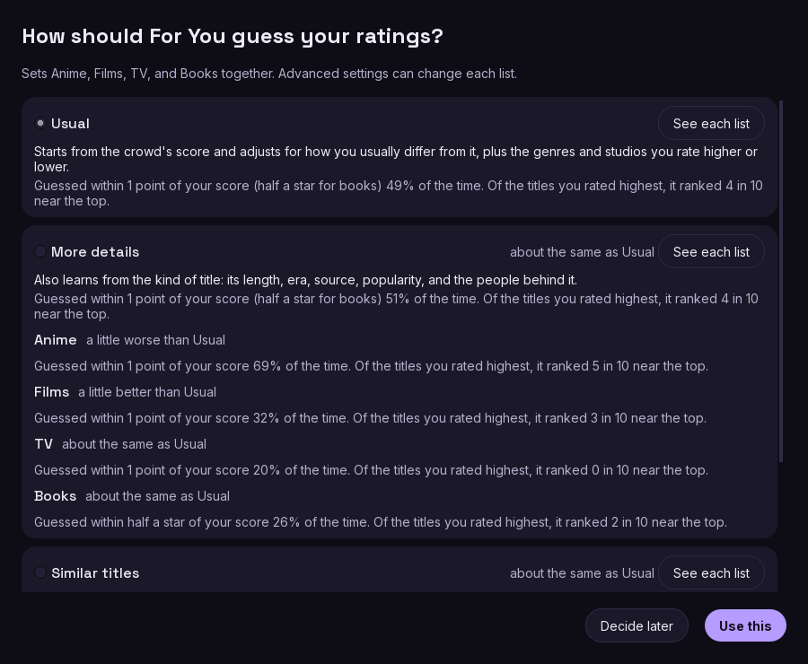

The question checks all four models against ratings hidden during fitting. Each row
shows how often it guessed within one point, how many of my highest-rated titles it
ranked near the top, and whether the paired check finds it better or worse than Usual.
Books use half a star instead of one point. The summary weights each list by its rated
count; See each list opens the separate results. Titles and pictures are never part of
this check, including adult anime when I hide them.

Use this applies my choice to anime, films, TV, and books and rebuilds the lists from
the cache. **Usual** stays the default until I choose. It starts from the crowd's score
and learns my usual difference, including the genres and credited people I rate higher
or lower. Advanced settings can still choose a different model for each list. The other
choices are experimental:

- **More details** learns from genres and studios, directors, creators, or authors, plus
  the details already saved for that medium. For anime those include format, source
  material, year, episode count, members, and popularity rank. Films also use language,
  decade, runtime, and vote count. TV uses language, decade, networks, season count, and
  vote count. Books use moods, literary type, decade, pages, and rating count.
- **Similar titles** looks for up to twenty similar titles I rated, using shared genres
  and credited people, plus MAL's recommendation links or Hardcover's similar-book links.
  It learns from how my ratings differ from the usual crowd line.
- **Blend** combines Usual, More details, and Similar titles. It chooses the mix using
  ratings held out inside its training part.

I can also compare the models in the lab:

```text
python -m taste --profile me lab --medium all
```

The lab opens an existing profile read-only, uses the same five folds for every model,
and prints aggregate numbers only, never titles, people, profile names, or item IDs. It
shows average error, rank agreement, how often predictions recover my top fifth, and a
paired interval against Usual. Only an interval wholly below zero counts as better. Books
use doubled stars on the 1 to 10 scale. With fewer than twenty ratings for a medium, it
prints the count without accuracy numbers. All fitting and tuning stay inside training
ratings, and every run uses the same rules and bootstrap seed.

The selected model uses the cache, without fetching more details. Its note in For You
uses the same plain accuracy wording as the question, and Behind the score names it too.
The within-one-point check uses raw guesses on the 1 to 10 scale; the anime lab also
shows whole-score errors, like the scores I give. The five-fold check is reused until my
ratings or the facts the model reads change, so recomputing an unchanged list does not
repeat that check.
Its chance of an 8 or more, or 4 stars, comes from that model's own held-out misses. The
switches for learning from Not interested, recent ratings, and borrowed themes apply to
Usual only. Dismissed picks stay hidden with every model. Across everything keeps
reranking the saved lists, and music keeps its listening model.

## Across everything

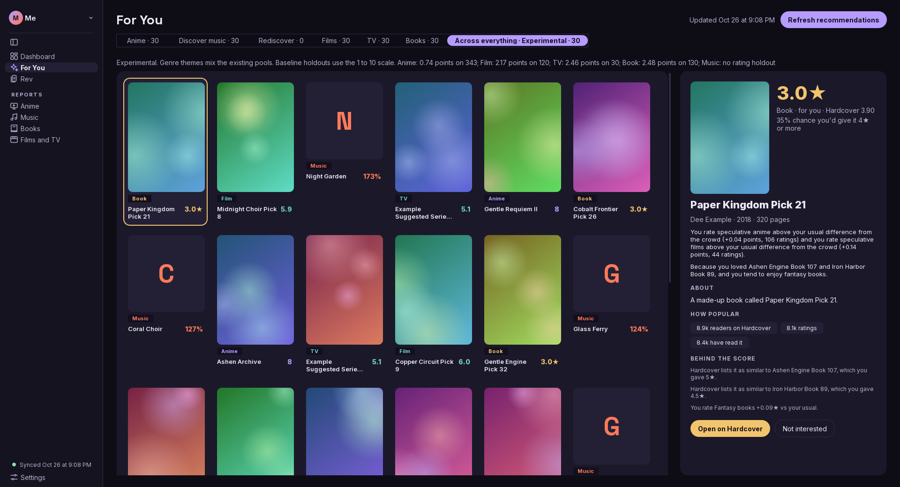

For You has an **Across everything** list after Books, marked Experimental. It ranks each
pick by how far its predicted score sits above my usual rating in that medium, divided by
my rating spread. The spread has a floor of one point, or half a star for books, so a tiny
spread cannot inflate a pick. Music has no personal ratings: I use rank percentiles within
Discover and Rediscover, converted to the same scale. Its mixed cards show those ranks.

Balanced is the default. It makes room in the first ten for each medium with a pick within
one rating spread of the best remaining pick, and avoids more than two from one medium in
a row while alternatives remain. Advanced settings also offers Best first, which follows
relative scores, and Strict rotation, which visits each available medium in turn.

All, Anime, Films, TV, Books, and Music filter the saved mix instantly. The app remembers
my filter for each profile. An **Outside your usual** card highlights a less-rated medium
or theme with a prediction above my actual usual. It is separate from the normal top pick
and counts toward the list size. If no qualifying pick exists, there is no surprise card.
Music and media without personal ratings cannot supply this rating-based surprise.

Each pick keeps its medium's color, with reasons naming the media and numbers behind it.
Shared genre themes add a small adjustment. A reason can name a title in another medium
only through an item identity or link already recorded in the database. Matching names,
people, or a label such as MAL's "novel" never establishes that link. Hidden adult anime
remain in the counts without appearing by title or picture.

I can inspect the broader theme map without writing anything or printing titles:

```text
python -m taste --profile me themes
```

It prints mapped title and tag counts per medium and up to twenty common unmapped terms.
Audience labels stay literal, such as "teen audience"; they do not imply a plot. Terms
such as awards and distribution formats stay unmapped. The map describes broad overlaps,
not the meaning of an individual item, and the other lists keep their existing models.

A third Advanced switch can let TV and books borrow theme leans from the other media while
their own ratings are sparse. It defaults off and the influence fades as their ratings grow.
Its separate off/on checks can get worse, so I check the numbers before using it. Not
interested on a pick hides it in both places, the mix and its own list, whichever one I press
it in. Theme overlap alone never links titles across sources.

## Experimental picks

Advanced settings has two switches, both off to start: learning a little from **Not interested**,
and giving dated ratings from the last two years 25% more weight. I can compare the separate
off/on holdout checks in each rated list's saved metrics before deciding whether to use them.
Off keeps the usual picks exactly. Dismissals still hide the item either way.

MAL's last list edit is only a proxy for a rating date. Hardcover does not supply a rating
timestamp, so its undated ratings keep their usual weight. Music plays are not ratings.
The usual accuracy line remains the baseline check; experiment checks are stored separately.

## Taste over time

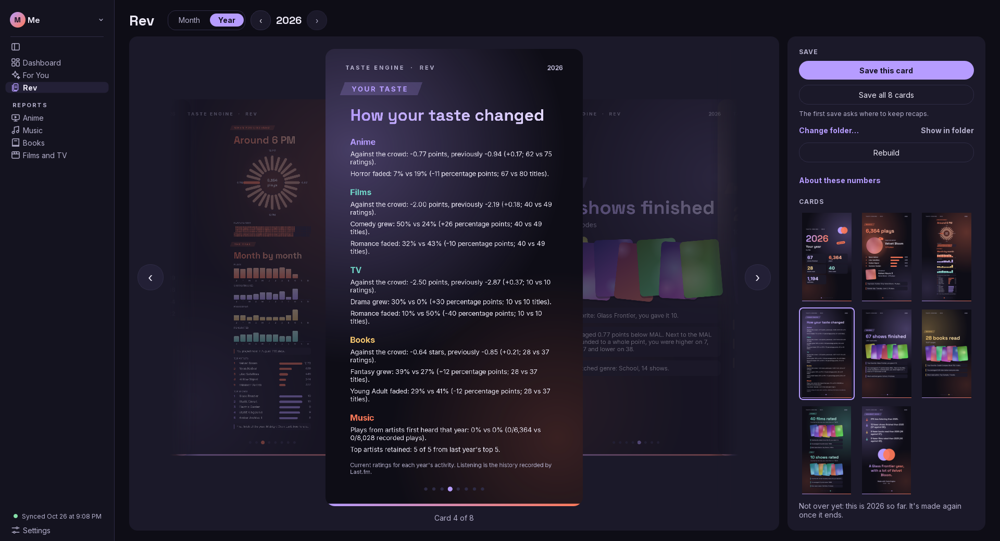

Yearly Rev decks can include **How your taste changed**, after the year card. I can compare
my current ratings against the crowd for each year's activity, genres that grew or faded,
and the share of my recorded plays from artists first heard that year. It stays quiet for
a medium without enough data in both years. The minimums are in Advanced settings. These
are comparisons of saved history, not snapshots of how I rated something years ago.

## Back up a profile

I can use **Settings > Data > Back up this profile** to save a `.tasteprofile` file, or run
`python -m taste --profile example_user backup example.tasteprofile`. It includes a consistent
copy of my database, my retained recaps, and my profile picture. It contains personal history,
so I keep it somewhere private. Keys and tokens stay out.

**Restore a profile** offers the backup's own id (what I want on a new computer), imports it
under that id or one I type if it's taken here, and switches to it. A backup from a newer
version of the app is refused. I enter its source keys again on Settings. From the command line I use
`python -m taste restore example.tasteprofile --as restored`. An existing profile or retained
recap folder is never replaced.

## Storage and timing

I keep raw responses so I can rebuild the staging data. Pages older than three days use
zlib and base64 in the background after a sync. Readers handle both formats, identical pages
still reuse the stored copy, and retention rules stay the same. When a quarter or more of the
database file is left empty that way, the sync compacts the file too, so it gets smaller on
disk (usually once, after the first compression). To measure the app without
my data or live APIs, I run `python scripts/time_app.py`, which builds the made-up test library
in a temporary folder and prints timings. They measure the made-up library, not my own.

## Known limitations

- **Last.fm only sees what scrobbles to it.** For most of my history that was desktop plays only (Tidal on my PC). My phone scrobbles now too, so newer plays cover more of my listening than older ones, and comparisons across that change aren't even. Either way it's a sample, not my full listening history. Each profile sets its own capture scope, every play keeps the scope it was synced under, and every Last.fm report and music suggestion says which scope applies.
- **The MAL list has to be public.** The app uses a client ID only, no login.
- **MAL watch dates are self-reported and often blank.** A completed show without a finish date gets the date I last edited the entry instead, labeled as an estimate. Those estimates cluster on days I bulk-edited my list, so "Recently finished" can show a batch of shows from the same day.
- **Tracks are matched by artist and title**, because MusicBrainz IDs are often missing. Different spellings of the same song count as different tracks.
- **Last.fm has no artist photos.** It returns the same blank image for every artist, so an artist's picture is the cover of their most played album (or their top album, for artists I've never played). When Last.fm has no cover at all, the picture is a photo from Deezer, and a Deezer photo also stands in when a cover can't be downloaded. Only an exact name match counts, so a few artists still get a lettered placeholder rather than a photo of someone else.
- **Music suggestions only know what Last.fm thinks is similar.** They come from Last.fm's similar artists, weighted by how much and how recently I play each artist.
- **Hours of music are estimates.** Scrobbles have no length, so the app looks lengths up on Last.fm, a few hundred tracks a sync: the recent months first, then the rest of my history until most plays have one. A track without a known length counts as a typical one, which is why it says "about". Until half the plays in a period have a length, it shows the hours it knows of ("112+") instead of a guess.
- **MAL doesn't keep a watch history.** For episodes per month, the app notes each time a sync sees my episode count go up. Before that, a finished show's episodes all count in the month it finished.
- **Book dates are whatever I entered on Hardcover.** A book counts in a month or year only if a read of it has a finish date. Books marked read with no date at all count in All time only, and the page says how many. Genres and moods are what Hardcover's readers tagged, so a book nobody tagged has none.
- **TMDB knows when I rated something, not when I watched it.** Films and TV are counted by the day I rated them and always say "rated", and rewatches aren't known.
- **No matching across sources yet** (for example an anime and its soundtrack).

## Credits

- Built with Python and [Qt for Python](https://doc.qt.io/qtforpython/) (PySide6, used under the LGPL 3.0), plus [requests](https://requests.readthedocs.io/), [keyring](https://github.com/jaraco/keyring), [python-dotenv](https://github.com/theskumar/python-dotenv), and [tzdata](https://github.com/python/tzdata).
- Fonts: [Space Grotesk](https://github.com/floriankarsten/space-grotesk) and [Inter](https://rsms.me/inter/), both under the SIL Open Font License.
- Anime data and posters come from [MyAnimeList](https://myanimelist.net/), music data and album covers from [Last.fm](https://www.last.fm/), artist photos from [Deezer](https://www.deezer.com/) when Last.fm has none, books and their covers from [Hardcover](https://hardcover.app/), and film and TV data and posters from [TMDB](https://www.themoviedb.org/). Taste Engine isn't affiliated with any of them. This product uses the TMDB API but is not endorsed or certified by TMDB.
- The Windows download includes the full license texts in `THIRD_PARTY_NOTICES.txt`.

## Privacy

Everything the app collects stays in files on my computer, recaps included. It talks to these services: MyAnimeList and Last.fm, with my usernames and API keys, to fetch my list and plays (and the synopses, bios, and counts for suggestions); TMDB and Hardcover, with the tokens from approving the app (read-only), to read my ratings, lists, and library; and Deezer's public artist search, which gets the names of suggested artists (no key or account) to find their photos. Hardcover's sign-in comes back to the app through a one-time listener on 127.0.0.1, which closes as soon as it's done. Pictures are downloaded only from those services' image servers. Nothing else leaves the computer.

## More

- [docs/DATA_DICTIONARY.md](docs/DATA_DICTIONARY.md): every table and column
- Screenshots: `docs/screenshots/`, drawn by the real app from the made-up library the tests use
- Tests: `pytest` (they never call the real APIs)
- License: MIT
